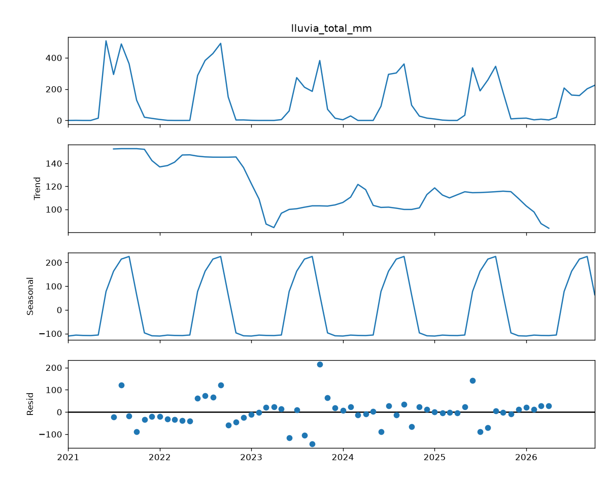
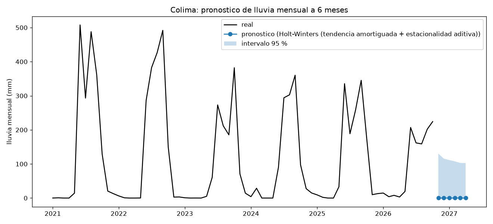

# Pronostico de la lluvia mensual · municipio de Colima

Generado automaticamente por `python -m laboratorio.pronostico` a partir de `data/oro/clima_municipio_mes.csv`.
Serie: 70 meses completos (2021-01 a 2026-10). Entrenamiento: 58 meses; prueba: los ultimos 12.

## 1. Caracterizacion y descomposicion

Descriptivos (mm/mes): {'count': 70.0, 'mean': 119.7, 'std': 151.9, 'min': 0.0, '25%': 2.3, '50%': 19.9, '75%': 210.7, 'max': 507.8}.
Se uso una descomposicion **aditiva** porque la serie tiene meses con 0 mm, en los que la multiplicativa no esta definida.
La estacionalidad explica aproximadamente el 79.0 % de la variacion de la serie.
Perfil estacional (mm sobre o bajo el nivel medio, por mes): {'01': -110.3, '02': -106.4, '03': -107.8, '04': -108.3, '05': -106.0, '06': 77.8, '07': 163.3, '08': 214.4, '09': 225.6, '10': 63.9, '11': -97.0, '12': -109.2}.

## 2. Estacionariedad, ACF/PACF y correlacion cruzada
Prueba de Dickey-Fuller aumentada sobre la serie: estadistico -7.312, p = 0.0 (rechaza raiz unitaria: si).
Sobre la diferencia estacional (12 meses): estadistico -7.393, p = 0.0.
Orden de diferenciacion no estacional elegido: d = 0; se aplica diferenciacion estacional D = 1 (s = 12) por el pico de la ACF en el rezago 12.

Correlacion cruzada de la lluvia del mes t con la variable k meses antes:
- radiacion solar: {0: -0.297, 1: 0.12, 2: 0.43, 3: 0.677, 4: 0.794, 5: 0.554, 6: 0.186}
- temperatura minima: {0: 0.552, 1: 0.598, 2: 0.453, 3: 0.185, 4: -0.161, 5: -0.538, 6: -0.784}

## 3. Cuatro modelos y seleccion por error en prueba
SARIMA: busqueda de ordenes por AIC en el entrenamiento; los 5 mejores: [{'orden': '(0, 0, 0)', 'estacional': '(0, 1, 1, 12)', 'AIC': np.float64(558.6)}, {'orden': '(0, 0, 0)', 'estacional': '(1, 1, 1, 12)', 'AIC': np.float64(559.2)}, {'orden': '(1, 0, 0)', 'estacional': '(0, 1, 1, 12)', 'AIC': np.float64(560.4)}, {'orden': '(0, 0, 1)', 'estacional': '(0, 1, 1, 12)', 'AIC': np.float64(560.4)}, {'orden': '(1, 0, 0)', 'estacional': '(1, 1, 1, 12)', 'AIC': np.float64(561.1)}].

| Modelo | MAE (mm) | RMSE (mm) | MAPE* | AIC (entrenamiento) |
|---|---|---|---|---|
| Holt-Winters (tendencia amortiguada + estacionalidad aditiva) | 43.7 | 67.0 | 73.1 % | 697.1 |
| SARIMA(0, 0, 0)x(0, 1, 1, 12) | 44.1 | 69.5 | 74.5 % | 558.6 |
| Suavizamiento exponencial simple | 117.1 | 141.4 | 1566.4 % | 742.3 |
| Holt (tendencia) | 131.3 | 154.1 | 1700.3 % | 746.3 |

\* MAPE calculado solo en los meses de prueba con lluvia real de 1 mm o mas (con 0 mm el porcentaje no existe).
Criterio de seleccion: **menor MAE**. Modelo ganador: **Holt-Winters (tendencia amortiguada + estacionalidad aditiva)**.

## 4. Pronostico a 6 meses (modelo ganador reajustado con toda la serie)
| Mes | Pronostico (mm) | Intervalo de prediccion 95 % (mm) |
|---|---|---|
| 2026-11 | 0.0 | 0.0 a 130.5 |
| 2026-12 | 0.0 | 0.0 a 115.8 |
| 2027-01 | 0.0 | 0.0 a 111.3 |
| 2027-02 | 0.0 | 0.0 a 107.7 |
| 2027-03 | 0.0 | 0.0 a 103.2 |
| 2027-04 | 0.0 | 0.0 a 102.5 |

Los valores negativos se recortan a 0 porque no existe lluvia negativa.

**Frase para el cliente:** para 2026-11 se esperan alrededor de 0 mm de lluvia en el municipio de Colima, con un rango probable de 0 a 130 mm.

## 5. Diagnostico de residuos del modelo ganador
- Ljung-Box (12 rezagos): estadistico 9.48, p = 0.6618 -> residuos autocorrelacionados: no.
- Levene (primera vs segunda mitad): estadistico 2.21, p = 0.1415 -> varianza cambia: no.
- Shapiro-Wilk: estadistico 0.947, p = 0.0052 -> residuos no normales: si.

