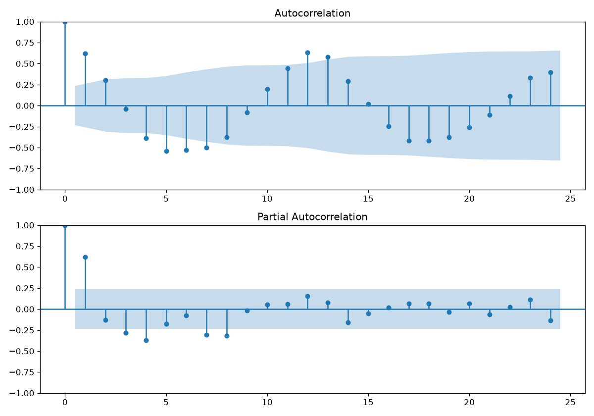
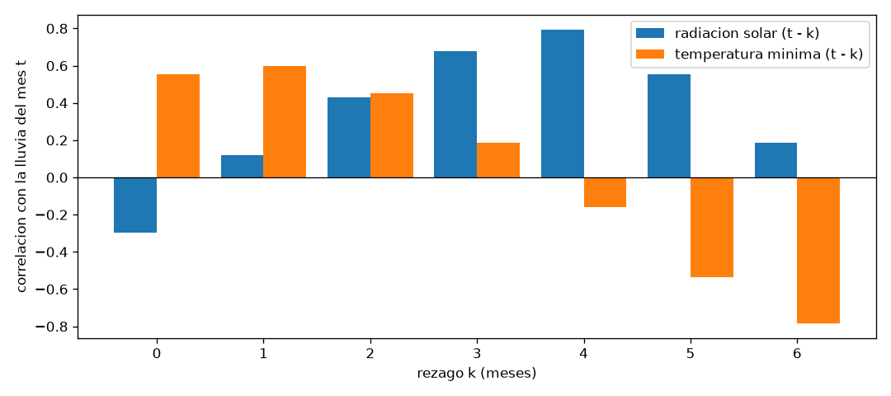
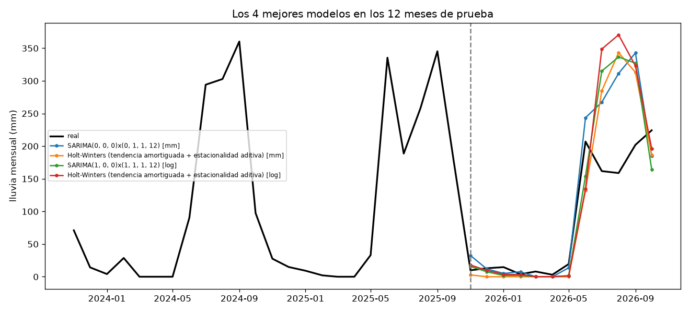
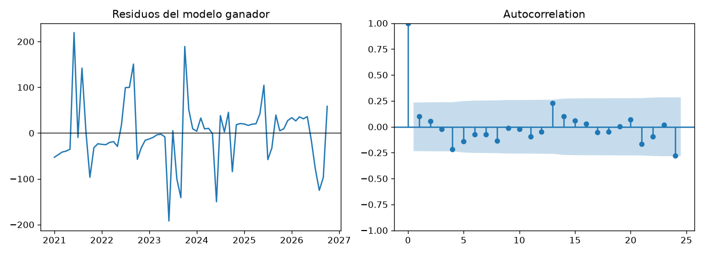

# Pronostico de la lluvia mensual · municipio de Colima

Generado automaticamente por `python -m laboratorio.pronostico` a partir de `data/oro/clima_municipio_mes.csv`.
Serie: 70 meses completos (2021-01 a 2026-10). Entrenamiento: 58 meses; prueba: los ultimos 12.

## 1. Caracterizacion y descomposicion

Descriptivos (mm/mes): {'count': 70.0, 'mean': 119.7, 'std': 151.9, 'min': 0.0, '25%': 2.3, '50%': 19.9, '75%': 210.7, 'max': 507.8}.
Se uso una descomposicion **aditiva** porque la serie tiene meses con 0 mm, en los que la multiplicativa no esta definida.
La estacionalidad explica aproximadamente el 79.0 % de la variacion de la serie.
Perfil estacional (mm sobre o bajo el nivel medio, por mes): {'01': -110.3, '02': -106.4, '03': -107.8, '04': -108.3, '05': -106.0, '06': 77.8, '07': 163.3, '08': 214.4, '09': 225.6, '10': 63.9, '11': -97.0, '12': -109.2}.

## 2. Estacionariedad, ACF/PACF y correlacion cruzada
Prueba de Dickey-Fuller aumentada sobre la serie: estadistico -7.312, p = 0.0 (rechaza raiz unitaria: si).
Sobre la diferencia estacional (12 meses): estadistico -7.393, p = 0.0.
Orden de diferenciacion no estacional elegido: d = 0; se aplica diferenciacion estacional D = 1 (s = 12) por el pico de la ACF en el rezago 12.

Correlacion cruzada de la lluvia del mes t con la variable k meses antes:
- radiacion solar: {0: -0.297, 1: 0.12, 2: 0.43, 3: 0.677, 4: 0.794, 5: 0.554, 6: 0.186}
- temperatura minima: {0: 0.552, 1: 0.598, 2: 0.453, 3: 0.185, 4: -0.161, 5: -0.538, 6: -0.784}

## 3. Cuatro modelos, dos escalas y seleccion por error en prueba
Cada modelo se ajusto en dos escalas: **mm** (milimetros directos) y **log** (se modela log(1 + mm) y el pronostico se regresa a mm con exp(x) - 1). El error siempre se mide en mm sobre los 12 meses de prueba.
SARIMA: busqueda de ordenes por AIC en el entrenamiento, por escala; los 5 mejores: {'mm': [{'orden': '(0, 0, 0)', 'estacional': '(0, 1, 1, 12)', 'AIC': 558.6}, {'orden': '(0, 0, 0)', 'estacional': '(1, 1, 1, 12)', 'AIC': 559.2}, {'orden': '(1, 0, 0)', 'estacional': '(0, 1, 1, 12)', 'AIC': 560.4}, {'orden': '(0, 0, 1)', 'estacional': '(0, 1, 1, 12)', 'AIC': 560.4}, {'orden': '(1, 0, 0)', 'estacional': '(1, 1, 1, 12)', 'AIC': 561.1}], 'log': [{'orden': '(1, 0, 0)', 'estacional': '(1, 1, 1, 12)', 'AIC': 134.2}, {'orden': '(1, 0, 0)', 'estacional': '(0, 1, 1, 12)', 'AIC': 134.3}, {'orden': '(0, 0, 1)', 'estacional': '(1, 1, 1, 12)', 'AIC': 134.4}, {'orden': '(0, 0, 1)', 'estacional': '(0, 1, 1, 12)', 'AIC': 134.5}, {'orden': '(1, 0, 0)', 'estacional': '(1, 1, 0, 12)', 'AIC': 134.7}]}.

| Modelo [escala] | MAE (mm) | RMSE (mm) | MAPE* | AIC (entrenamiento) |
|---|---|---|---|---|
| SARIMA(0, 0, 0)x(0, 1, 1, 12) [mm] | 44.1 | 69.5 | 74.5 % | 558.6 |
| Holt-Winters (tendencia amortiguada + estacionalidad aditiva) [mm] | 50.0 | 76.0 | 81.0 % | 680.5 |
| SARIMA(1, 0, 0)x(1, 1, 1, 12) [log] | 52.0 | 80.5 | 70.5 % | 134.2 |
| Holt-Winters (tendencia amortiguada + estacionalidad aditiva) [log] | 56.0 | 91.7 | 70.0 % | 149.9 |
| Suavizamiento exponencial simple [log] | 109.0 | 129.4 | 1431.4 % | 225.7 |
| Suavizamiento exponencial simple [mm] | 117.0 | 141.4 | 1565.8 % | 740.6 |
| Holt (tendencia) [mm] | 175.1 | 185.7 | 1954.7 % | 745.7 |
| Holt (tendencia) [log] | 460.6 | 503.0 | 3077.5 % | 231.2 |

\* MAPE calculado solo en los meses de prueba con lluvia real de 1 mm o mas (con 0 mm el porcentaje no existe).
El AIC solo es comparable entre modelos de la misma familia y la misma escala; por eso la seleccion se hace con el error en prueba.
Criterio de seleccion: **menor MAE**. Modelo ganador: **SARIMA(0, 0, 0)x(0, 1, 1, 12) [mm]**.

## 4. Pronostico a 12 meses (modelo ganador reajustado con toda la serie)
| Mes | Pronostico (mm) | Intervalo de prediccion 95 % (mm) |
|---|---|---|
| 2026-11 | 22.9 | 0.0 a 200.8 |
| 2026-12 | 12.9 | 0.0 a 190.8 |
| 2027-01 | 10.1 | 0.0 a 187.9 |
| 2027-02 | 6.3 | 0.0 a 184.1 |
| 2027-03 | 3.7 | 0.0 a 181.6 |
| 2027-04 | 1.4 | 0.0 a 179.3 |
| 2027-05 | 18.2 | 0.0 a 196.1 |
| 2027-06 | 225.3 | 47.5 a 403.2 |
| 2027-07 | 208.1 | 30.2 a 386.0 |
| 2027-08 | 228.7 | 50.8 a 406.6 |
| 2027-09 | 275.3 | 97.4 a 453.2 |
| 2027-10 | 201.1 | 23.2 a 379.0 |

Los valores negativos se recortan a 0 porque no existe lluvia negativa. Escala del modelo ganador: **mm**.

**Frases para el cliente:**
- Para 2026-11 se esperan alrededor de 23 mm de lluvia en el municipio de Colima, con un rango probable de 0 a 201 mm.
- Para el mes mas lluvioso del pronostico (2027-09) se esperan alrededor de 275 mm, con un rango probable de 97 a 453 mm: conviene reservar toldos y personal con anticipacion para esa temporada.

## 5. Diagnostico de residuos del modelo ganador
- Ljung-Box (12 rezagos): estadistico 7.33, p = 0.8347 -> residuos autocorrelacionados: no.
- Levene (primera vs segunda mitad): estadistico 0.87, p = 0.3541 -> varianza cambia: no.
- Shapiro-Wilk: estadistico 0.85, p = 0.0 -> residuos no normales: si.

## 6. Reproducibilidad
Diagnostico (25-nov-2026): dos corridas con **el mismo archivo de datos** (misma huella SHA-256) y el mismo codigo de
ajuste dieron para Holt-Winters [mm] AIC 697.1 / MAE 43.7 y AIC 700.1 / MAE 47.3. Como el AIC cambio con datos
identicos, el optimizador termino en puntos distintos: con la inicializacion "estimated" buscaba 14 estados iniciales
ademas de los parametros de suavizamiento, un problema mal condicionado.
Correccion: (1) los modelos ETS usan `initialization_method="heuristic"` (estados iniciales con una regla fija) y
`maxiter=2000`; (2) el flujo `analisis` corre con un solo hilo de calculo numerico (`OMP_NUM_THREADS=1`) para que el
orden de las sumas no varie; (3) cada corrida guarda la huella de los datos y las versiones usadas, para fijarlas en
`requirements.txt` y poder distinguir si un cambio de resultado viene de los datos o del software.

- Huella de los datos (SHA-256 de `clima_municipio_mes.csv`): `b37eef955c2bb1c0dec6585c8d1297e412422c39e8dddc6ae2b025ad3e02b98c`
- Python 3.11.18; versiones: {'statsmodels': '0.15.0', 'pandas': '3.1.1', 'numpy': '2.4.6', 'scipy': '1.17.1', 'matplotlib': '3.11.2'}
- Convergencia del optimizador por modelo: {'Suavizamiento exponencial simple [mm]': True, 'Holt (tendencia) [mm]': True, 'Holt-Winters (tendencia amortiguada + estacionalidad aditiva) [mm]': True, 'SARIMA(0, 0, 0)x(0, 1, 1, 12) [mm]': True, 'Suavizamiento exponencial simple [log]': True, 'Holt (tendencia) [log]': True, 'Holt-Winters (tendencia amortiguada + estacionalidad aditiva) [log]': True, 'SARIMA(1, 0, 0)x(1, 1, 1, 12) [log]': True}
